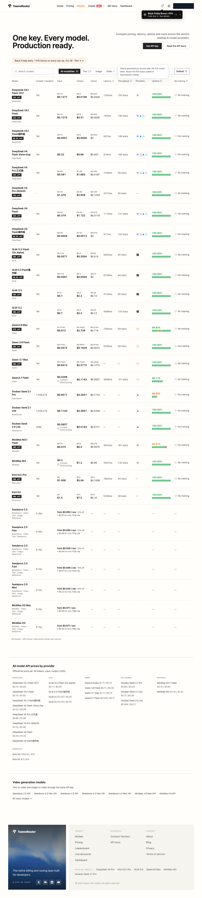
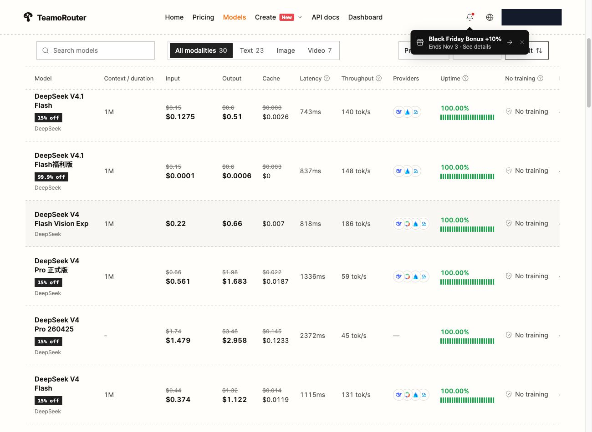

# TeamoRouter 中转站测评：30 个模型的美元计价，和按秒卖的 Seedance 视频怎么算

TeamoRouter 把文本、视频两类模型放在同一套 OpenAI / Anthropic 兼容网关下，目录页当前列出 **30 个模型**（文本 23、视频 7）。它最不一样的地方是**全部用美元标价**：文本按 USD / 百万 token 给输入、输出、Cache 三列，视频按秒给起价。对需要同时跑长文和短视频生成的人来说，一个账户、一套 Key 就能覆盖两类任务。

[查看 TeamoRouter 当前模型与价格](https://teamorouter.com/share?i=e6d77aac74)

> **Decision:** 当你需要「文本 + 视频」同一个网关、且习惯按美元算账时选它；只需要最低价文本模型、或必须用人民币充值时，它不是最优解。
>
> **For:** 同时跑代码/长文与 Seedance 视频生成的开发者、按美元预算做成本核算的团队  ·  **Not for:** 只买一个廉价文本模型的人、必须走支付宝人民币充值的用户

## 30 个模型分成两类，计价单位完全不同

文本模型按 **USD / 1M token** 计费，输入、输出、Cache 三列分开；视频模型按 **每秒** 给起价，另外标注 5 秒样例的估算总价。这两类不能放在同一张表里比单价 —— 一个是 token，一个是秒。

当前目录的筛选计数是 **All modalities 30 / Text 23 / Video 7**，Image 分类没有条目。这个数字来自站内真实筛选器，不是把重复布局或链接累加出来的。

| 类型 | 代表型号 | 计价单位 | 上下文 / 时长 |
|---|---|---|---|
| 文本 | DeepSeek V4.1 Flash | $0.3 / $1.2 每百万 token | 1M |
| 文本 | GLM-5.3 | $1.4 / $4.4 每百万 token | 1M |
| 文本 | Qwen3.8 Max | $1.7143 / $5.1429 每百万 token | 1M |
| 文本 | Kimi K3.1 Pro | $2 / $10 每百万 token | 1M |
| 视频 | Seedance 2.5 | from $0.090 / 秒 | 4–30s |
| 视频 | Seedance 2.0 Mini | from $0.030 / 秒 | 4–15s |

## 价格表里有两行数字，别把它们相加

目录单元格常见「原价 / 折后价」两行并排，例如 DeepSeek V4.1 Flash 输入写作 `$0.3` 与 `$0.255`，附注 `15% off`。**下面那行是折扣后的实付价，不是第二个收费项。** 把两行加起来的算法会高估一倍。

另外有一类标着 `99.9% off` 的「福利版」型号，折后价低到 $0.0001 量级。这类价格确实存在于目录里，但它属于限时活动档，**下单前必须回目录确认当时是否仍在售**，不能按常态价做长期预算。

还有几个型号标 `Context-tiered pricing`：上下文长度不同，单价不同。这类不能只看列表里那一个数字，要按自己实际会喂多长的上下文去估。

## 视频按秒算，先算一条片子的总价

Seedance 系列给的是「每秒起价」，同时给一个 5 秒样例的估算。以 Seedance 2.0 为例：from $0.059 / 秒，5 秒 720p 约 $0.64。计算方式就是单价 × 秒数，再考虑分辨率和档位是否加价。

做视频预算的顺序应该是：定型号 → 定分辨率 → 定单条时长 → 乘出单条成本 → 再乘一周要出的条数。反过来先充钱再看能出几条，很容易中途断粮。

## 充值与接入

公开充值档位是 **$10 / $20 / $50 / $200**，自定义金额最低 **$5**，走 Stripe checkout，余额按美元面值入账。站方说明无订阅制、Credits 不过期。

接入方式：首页给出的 base URL 是 `https://api.teamorouter.cn/v1`，支持 OpenAI 与 Anthropic 两种兼容协议。这意味着现有的 OpenAI SDK、Cherry Studio、Claude Code 一类客户端可以直接填地址和 Key 使用，不需要改代码结构。

第一次接入建议只跑一次最小调用：发一句短提示，确认返回正常、扣费正确，再上批量任务。跳过这一步直接跑长任务，出问题时分不清是协议填错还是额度不足。

[从小额开始验证接入](https://teamorouter.com/share?i=e6d77aac74)

## 适合替代哪些方案

如果你现在为了跑视频单独买一个生成平台、为了跑文本再买一个 API 站，TeamoRouter 可以把两笔账合成一笔，省掉两套余额、两把 Key、两份账单。如果你只用文本，并且对单价极度敏感，那用专门的低价文本站更划算 —— 视频能力对你没有价值，但它的定价结构里包含了这部分供给。

## 三类任务分开建 Key

按任务倒推比按型号挑更省时间：

- **批量短视频**：Seedance 2.0 Mini 起步，跑通再考虑 2.5；预算按「条数 × 秒数 × 单价」算。
- **日常文本/代码**：DeepSeek 或 GLM 的折扣档，先跑通客户端和计费。
- **长文档分析**：选 1M 上下文档位，并且优先看 Cache 读价，而不是只看输入价。

这三类不要共用一条 Key。混用之后账单无法归因，也就没法判断哪一类该加预算、哪一类该砍。

## 它没有的东西

当前 30 个型号里 **Image 分类为空**。如果你的主任务是批量出图，这里没有按张计费的供给，应该另找按次计费的站，而不是拿视频型号替代。

另外，视频型号只覆盖 Seedance 一个家族，没有 Kling、Veo、Runway 等其他供给。需要多供应商横比时，这里只有一个选择，谈不上比价。

## 购买建议

先按任务分两条 Key：一条只跑文本、一条只跑视频，各自设额度。文本先用 DeepSeek 或 GLM 的折扣档跑通客户端和计费，视频先用 Seedance 2.0 Mini 跑一条 5 秒片确认出片质量和扣费，再决定要不要上 2.5。首充 $10 足够跑完这套验证。

[按当前价目表确认自己的型号与档位](https://teamorouter.com/share?i=e6d77aac74)

## Related guides

同账号还有几篇按场景拆开的中转站测评，配合看更容易选：

- [哈基米 API 测评](https://github.com/cw11ark/hakimi-api-review) —— 261 个模型、生图按次计费，适合先确认「模型多」是不是你的核心需求
- [VS 云测评](https://github.com/cw11ark/vsllm-review) —— 按次计费的低成本文本路线，适合高频短请求
- [斑马 API 测评](https://github.com/cw11ark/banma-api-review) —— 另一条 OpenAI 兼容网关，可做同任务交叉比价

## FAQ

### 文本和视频要分开充值吗？

不用，同一个账户余额覆盖两类计费。但建议分开建 Key 并各自设额度，避免视频任务把文本预算吃光。

### 折扣价会一直有效吗？

不会。目录里的 `xx% off` 是阶段性活动价，站方说明价格随上游成本变化、按请求当时价格计费。做长期预算时按原价算，把折扣当余量。

### 支持哪些客户端？

任何能填自定义 base URL 的 OpenAI 兼容客户端都可以。Anthropic 协议另有独立入口，用 Claude Code 一类工具时选对应协议。

---

如果这篇帮你省下了比价时间，给这个仓点个 star，后面更新价目和实测时你能直接收到。
